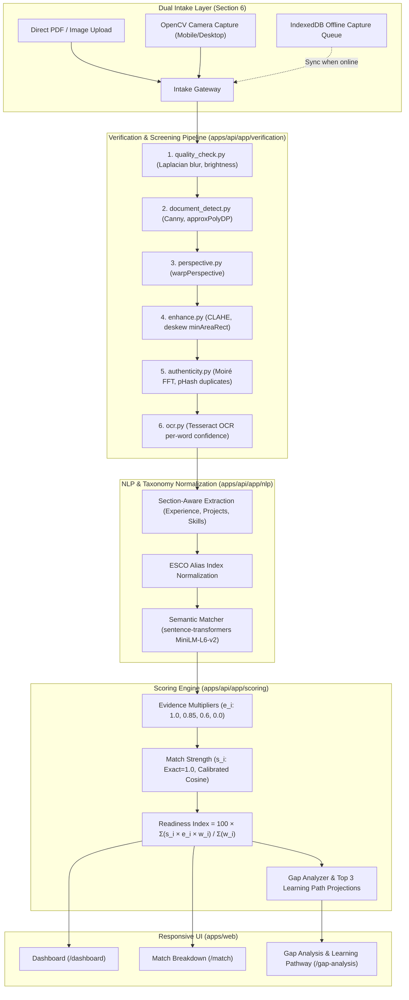

# SkillLens AI — Resume–Job Skill Matching & Gap Analyzer

> **Capstone Project**: AICTE IBM SkillsBuild Machine Learning & Applied AI Internship Program 2026  
> **Global Alignment**: United Nations Sustainable Development Goal 8 (**SDG 8: Decent Work and Economic Growth**) — Targets 8.5 & 8.6

---

## 1. Problem Statement

Millions of job seekers—particularly first-generation university graduates, rural and semi-urban youth, and vocational career switchers—are routinely overlooked by contemporary hiring pipelines not because they lack capability, but because their skills remain **invisible** to algorithmic screening systems:

1. **Unverifiable Claims & Inflexible ATS Keyword Filters**: Typical resumes list ungrounded skill keywords that recruiters cannot reliably authenticate. Conversely, rigid Applicant Tracking Systems (ATS) discard qualified applicants merely because they express skills using colloquialisms or abbreviations (`"ML"` vs. `"Machine Learning"`, `"k8s"` vs. `"Kubernetes"`).
2. **Exclusion of Physical & Hardcopy Credentials**: Job candidates in rural and non-metropolitan areas frequently hold tangible physical printed resumes, vocational diplomas, and physical course completion certificates that standard digital-first HR software cannot ingest.
3. **Absence of Actionable Feedback**: Discarded applicants receive opaque automated rejections without insight into the specific competency delta separating them from the role or actionable guidance on what credential or project to pursue next.

**SkillLens AI** resolves these systemic barriers by:
- Normalizing extracted candidate skills against the multilingual **European Skills, Competences, Qualifications and Occupations (ESCO)** taxonomy.
- Providing dual intake pipelines: standard digital PDF upload and **OpenCV-assisted mobile hardcopy camera capture** with live perspective rectification.
- Rigorously evaluating candidate skills through **evidence-weighted scoring** (Verified, Demonstrated, Claimed, Absent).
- Computing an explainable **Readiness Index (0–100)** and formulating high-ROI, concrete **Learning Pathways** with projected readiness estimations.

---

## 2. Key Product Differentiators

- **Evidence-Weighted Skills**: Skills are not scored as binary indicators. A skill earns maximum weight only with verifiable artifacts (resolving public repository URLs or verifiable certificate IDs), preventing cosmetic resume inflation.
- **Dual Intake Modes**: Direct PDF/image upload and camera-based physical document capture powered by OpenCV computer vision (contour detection, 4-point perspective warp, adaptive contrast thresholding).
- **Taxonomy Normalization**: All competencies resolve to standardized ESCO skill nodes, rendering candidate synonyms and abbreviations immediately transparent to recruiters.
- **Projected Readiness Index**: Computes candidate baseline fit (0–100) alongside an estimated index upgrade upon completing the top 3 recommended learning milestones.
- **Offline-First Resilience**: Mobile candidates with intermittent connectivity can capture, crop, and queue documents locally in IndexedDB (`idb`), synchronizing automatically upon network reconnection.
- **Cross-Device Universal Access**: Engineered mobile-first to ensure 100% feature parity across 320px smartphones, tablets, laptops, and ultra-wide desktops.

---

## 3. System Architecture



---

## 4. Scoring Methodology

### Evidence Levels & Multipliers ($e_i$)

| Level | Name | Multiplier ($e_i$) | What it Establishes | What it Does NOT Establish |
|---|---|---|---|---|
| **Level 3** | Verified | **1.00** | Supported by a checkable artifact (e.g., public GitHub repository URL or validated credential ID). | Does not prove the physical document is authentic or that the candidate worked without assistance. |
| **Level 2** | Demonstrated | **0.85** | Self-described work experience or project entry with concrete, quantified outcomes (e.g., "reduced latency by 30%"). | Self-reported; unverified against third-party enterprise records. |
| **Level 1** | Claimed | **0.60** | Skill keyword listed in skills section or bullet points without supporting outcome context. | Self-described only; no demonstrable proof of proficiency. |
| **Level 0** | Absent | **0.00** | No mention or evidence discovered in the parsed document. | Does not definitively prove the candidate lacks unlisted skill. |

### Semantic Match Strength ($s_i$)
- $s_i = 1.0$ for exact canonical or alias matches via the normalized ESCO taxonomy index.
- For semantic matches via `sentence-transformers (all-MiniLM-L6-v2)`, cosine similarity is mapped using a stepped calibration table:
  - $\text{cosine} \ge 0.92 \longrightarrow s_i = 0.95$
  - $0.85 \le \text{cosine} < 0.92 \longrightarrow s_i = 0.85$
  - $0.78 \le \text{cosine} < 0.85 \longrightarrow s_i = 0.70$
  - $\text{cosine} < 0.78 \longrightarrow s_i = 0.00$
  *(Scores are explicitly flagged as **Uncalibrated Baseline** until validated against the 100 candidate–skill test benchmark).*

### Readiness Index Formula
$$\text{Readiness Index} = 100 \times \frac{\sum_{i} (s_i \times e_i \times w_i)}{\sum_{i} w_i}$$
*Summed exclusively over required skills with job importance weights $w_i \in \{1, 2, 3\}$. Result is clamped to $[0, 100]$ and rounded to the nearest integer.*

### Gap Severity Classification
- **High Severity**: $w_i = 3$ and $s_i \times e_i < 0.50$
- **Medium Severity**: $w_i = 2$ and $s_i \times e_i < 0.50$, OR $w_i = 3$ and $0.50 \le s_i \times e_i < 0.85$
- **Low Severity**: All other requirements with $s_i \times e_i < 1.00$

### Projected Readiness
Recomputed Readiness applying evidence upgrades for the **top 3 recommended learning steps** only, ranked strictly by efficiency ratio:
$$\text{Priority} = \frac{\Delta \text{Readiness}}{\text{Estimated Effort (Weeks)}}$$
*The projected readiness is always explicitly labeled **"Estimated"** and assumes the steps are completed and verification artifacts are validated.*

---

## 5. Security, Privacy & Auth Hardening (Section 8)

- **Upload Signature Validation**: File types are validated using magic byte headers (`%PDF-`, PNG, JPEG signatures), not user-supplied MIME types or extensions.
- **Strict Size & Dimension Limits**: Maximum 10 MB per file, max 5 PDF pages, max $4000 \times 4000$ px (16 MP). Password-protected PDFs and PDFs containing active JavaScript or launch actions are automatically rejected.
- **Metadata Sanitization**: All EXIF and GPS geolocation metadata tags are stripped prior to disk persistence.
- **Isolated Storage**: Randomized storage filenames stored outside web accessible roots. Temporary files are destroyed in dedicated `finally` blocks.
- **Authentication Hardening**: `httpOnly`, `Secure`, `SameSite=Lax` cookies; refresh-token family rotation in MongoDB with instant revocation upon reuse detection.
- **Open-Redirect Hardening**: The `?next=` query parameter strictly validates against single-slash relative app paths, blocking absolute URLs, backslashes, and protocol-relative `//` bypasses.

---

## 6. Getting Started & Local Development

### Prerequisites
- Node.js 20+
- Docker & Docker Compose
- Python 3.11+ (if running backend outside Docker)

### One-Command Startup (Docker Compose)
```bash
docker-compose -f infra/docker-compose.yml up --build
```
- Frontend Web: [http://localhost:3000](http://localhost:3000)
- Backend FastAPI: [http://localhost:8000](http://localhost:8000)
- API Swagger Docs: [http://localhost:8000/docs](http://localhost:8000/docs)
- MongoDB: `localhost:27017`

### Running Tests
```bash
# Automated WCAG contrast & unit verification
npm test

# Cross-device Playwright viewport matrix
npx playwright test
```

---

## 7. Open Decisions for Mentor Review (Phase 1)

1. **Database Driver Choice**: Maintain `motor` (legacy async driver) or upgrade to native `pymongo.AsyncMongoClient` (PyMongo 4.6+ Async API)?
2. **Design System Text Accent Approval**: Approve proposed **Cyan Text `#0E7490`** (4.9:1 contrast, passing WCAG AA) for links, small accents, and focus rings on White Mist (`#F3F6F8`)?
3. **Semantic Matching Calibration**: Approve the placeholder stepped calibration table pending evaluation on the 100-pair labeled validation set?
